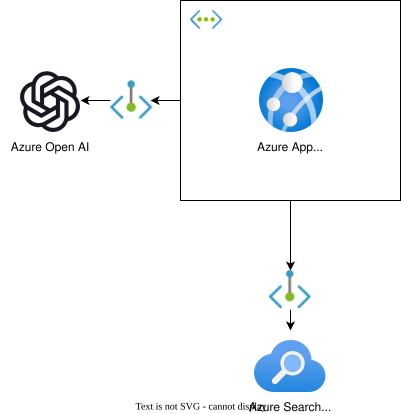

# OpenAI Azure Terraform

Sets up a sample Azure OpenAI infrastructure project with security considered

## Architecture

- Azure OpenAI is only accessible from this VNET. Please see more information here: https://learn.microsoft.com/en-us/azure/ai-services/cognitive-services-virtual-networks?tabs=portal

## Features

This project framework provides the following features:

- Sets up app service, Azure OpenAI service, cognitive search service, private endpoint, and VNet

## Resources

- [📖 Docs: Configure Foundry Tools virtual networks](https://learn.microsoft.com/en-us/azure/ai-services/cognitive-services-virtual-networks?tabs=portal)
- [📖 Docs: Foundry Models sold by Azure](https://learn.microsoft.com/en-us/azure/ai-services/openai/overview)
- [📖 Docs: What are Foundry Tools?](https://learn.microsoft.com/en-us/azure/ai-services/what-are-ai-services)
